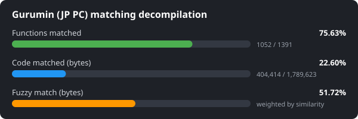
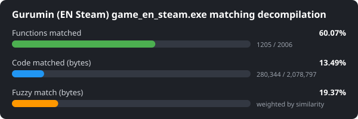

# Gurumin decompilation and modding

A matching decompilation of **Gurumin** (Japanese PC release, 2006) together with tools and documentation for
modding it. The target is the game code in `bin\APP.dll` and the helper DLLs next to it (`Packs.dll`, `SoundArc.dll`,
`sound3d.dll`). The goals, in order:

1. **Moddability:** readable source, named functions and documented file formats, so changes are easy to make.
2. **Modern hardware:** lift the 2006-era limits (frame rate, resolution, text rendering, input) on today's PCs.
3. **A byte-matching rebuild:** every function compiles back to the original bytes with the original compiler.

No game files are included. Point the tools at your own copy of the game.

## Progress

### Japanese PC release (APP.dll and helper DLLs, Visual C++ .NET 2002)

The JP meter counts the whole game: APP.dll (`decomp/`) plus the helper DLLs, each in its own tree with the same
compiler: Packs.dll, the image and archive codec (`decomp_packs/`), and SoundArc.dll, the sound server
(`decomp_soundarc/`). Statically linked libraries (the C runtime, libjpeg) are not counted.

### English Steam release (game_en_steam.exe, Visual C++ 2013)

The EN project lives in `decomp_en/` and reuses the JP work: `decomp_en/jp_en_map.tsv` pairs 1,143 of its 2,034
game functions with their JP twins, and matched JP source is ported as the first draft. Library code linked into
the exe (MFC, the C runtime) is not counted.

The meters are regenerated with every progress report and refreshed by CI on each push to `master`; the same data is
published as the `jp_report` and `en_report` artifacts for ByteMatch. In the JP project, matched functions are the smaller ones
so far: a few very large functions (the model loader at 0x1017cc90 alone is 29,886 bytes) hold most of the code, so
the byte share lags the function share. `python decomp/tools/build_all.py` prints the current figures and
`decomp/tools/todo.py` lists what is left.

## What you can do today

### Modding tools (`tools/`, Python 3; Pillow for images)
| Tool | Does |
|---|---|
| `itm_tool.py decode/encode` | `.itm` scripts, tables and BMPs (map.itm, 3ddata\*.itm) ↔ plain text. 2,511 files round-trip. |
| `iti_tool.py decode/encode/info` | `.iti` textures ↔ PNG (all types; 666/667 via your packs.dll and tools/native/iti_unpack.c; writes raw type 0/1). |
| `it3_tool.py info/obj` | `.it3` model node list; OBJ export with normals and UVs. All 945 JP models decode. |
| `gpack.py` | Python port of packs.dll `ExecUnpack` (used by .it3 meshes). |
| `mmv_tool.py info/frames/gif/encode` | `.mmv` movies ↔ PNG frames or GIF. All 67 JP movies rebuild byte-identical. 2x/4x frames make HD movies. |
| `de2_tool.py info/decode/encode` | `.de2` music ↔ WAV (MS ADPCM; encoding untested in game). |
| `ddfont_tool.py export/import` | in-game font ↔ PNG atlas (byte-identical round trip). |
| `dialogue_tool.py export/import/stats` | all of the game's text (dialogue, messages, menu choices, names, cutscene subtitles) ↔ one TSV for translators. |
| `asset_groups.py`, `mod_install.py` | sort game files by character or type; install a mod's files into the game's `mod\` folder. |
| `save_tool.py decode/encode/info/thumb` | `SaveData\gdataNN.sav` ↔ raw state; thumbnail extract. |
| `script_api.py`, `gen_script_api_md.py` | script built-in list → `docs/SCRIPT_API.md`. |
| `config_keys.py`, `save_layout.py` | gurumin.def key map, save body map (from the decompiler output). |
| `gurumin_tools_gui.py` | one window for all of the above (Tkinter, no extra install): see below. |

### Modding GUI
`python tools/gurumin_tools_gui.py` opens one window over all the tools: pick the game folder once, then export
files to editable PNG/text/WAV/OBJ/GIF, import them back, or batch-convert whole folders. The **Mod** tab exports
game files into a mod folder (`edit\`), sorted by character (`Characters\Parin`, `Enemies\Slime`, ...) or type,
shows which ones you changed, repackages them into `out\` with the game's folder layout and installs them into the
game's `mod\` folder for the mod DLL. The **Dialogue** tab lists all 4,937 lines of text (dialogue boxes with their
speaker, messages, menu choices, names, cutscene subtitles), lets you search and edit them and previews each line in
the game's own font. The game folder is only read. Walkthrough: [`docs/GUI.md`](docs/GUI.md).

No Python? `GuruminModTools.exe` (Windows) or `GuruminModTools` (Linux x64/arm64) is the same window as one program
(Python, Pillow, the tools and the mod DLLs inside; no game files). Build it with `python tools/build_exe.py` (needs
`pip install pyinstaller pillow`); it lands in `dist\`. On Linux, 666/667 textures need Wine for `iti_unpack.exe`.

### Mod DLL (`mod/`): replacement files and HD movies
A `d3d9.dll` for the Japanese PC version, loaded next to `game.exe`; it changes nothing on disk. It loads any
game file from a `mod\` folder in the game folder in place of the original, by name, and turns PNG textures of any
size up to 2048x2048 into the game's format on the fly ([`docs/MODDING_FILES.md`](docs/MODDING_FILES.md)). It plays `.mmv`
movies made at 2x or 4x their original size at the original size on screen with the extra detail
([`docs/MOVIES_HD.md`](docs/MOVIES_HD.md)). `mmv_tool.py encode` and the GUI make an HD movie from larger frames
on their own, and the GUI's repackage adds the DLL to `out\`. Install by hand with
`mod\install.bat "C:\path\to\Gurumin"`. Widescreen and any resolution are in the same DLL but parked and off
([`docs/DISPLAY_MOD.md`](docs/DISPLAY_MOD.md)). An orbit camera (right stick or mouse, zoom) and higher-resolution
dynamic shadows, ported from Gurumin Enhanced Rendering, are also in it, off by default and untested on the JP game
([`docs/CAMERA_SHADOWS_JP.md`](docs/CAMERA_SHADOWS_JP.md)).

### English Steam release: Enhanced Rendering mod (`mod_en/`)
The MIT-licensed **Gurumin Enhanced Rendering** mod by ObeseCatLord (v1.3.0) for the English Steam `game.exe`
(`game_en_steam.exe` here): a `d3d9.dll` proxy plus an x64 OpenXR host. Any resolution including ultrawide,
proportional HUD, render interpolation above the game's 30 Hz, FXAA, high-resolution shadows, a free/orbit camera
with zoom, 6DoF VR on PC VR, Linux/Proton and Steam Deck, and standalone VR on the Steam Frame. Build with
`mod_en/build.sh` (MinGW-w64); install and the address table (mod hooks ↔ `decomp_en` names) are in
[`mod_en/README.md`](mod_en/README.md). Releases and full settings:
[gurumin-enhanced-rendering](https://github.com/ObeseCatLord/gurumin-enhanced-rendering).

### Builds
CI ([`.github/workflows/build.yml`](.github/workflows/build.yml)) builds the JP mod DLL (`mod-jp`), the EN mod with
its VR host (`mod-en`) and the modding tools as one program for Windows x64, Linux x64 and Linux arm64
(`GuruminModTools-windows-x64`, `-linux-x64`, `-linux-arm64`) on pushes to master and on pull requests; download
them from the run's artifacts.

### Documentation (`docs/`)
`MODDING_MAP.md` (start here: costumes, anti-cheat guards, render states, sound, menu images), `MODDING_FILES.md`
(replacement files), `TEXT.md` (dialogue and subtitles), `GUI.md`, `ITM_FORMAT.md`,
`SCRIPT_API.md`, `MAP_TABLES.md`, `SAVE_FORMAT.md`, `PACKS_DLL.md`, `config_keys.tsv`, `save_layout.tsv`.
Function names: `symbols.tsv` (apply to Ghidra with `re/apply_symbols.bat`).

## Decompilation (`decomp/`)
- Compiler: Visual Studio .NET 2002, cl 13.00.9466, the exact build in APP.dll's Rich header (`decomp/env.bat`; set
  `GURUMIN_VC` to another `Vc7` folder to override). Flags `/O2 /Ob1 /Op /Gy /GS /GX`; experiment flags go in
  `GURUMIN_CFLAGS`.
- Build and compare: `decomp\build.bat <file.cpp>` compiles one file and byte-compares every function with APP.dll
  (relocations masked); `decomp\build_all.bat` or `python decomp/tools/build_all.py --report progress/jp/report.json`
  does everything and writes the report and the meter.
- Helpers: `tools/variants.py` builds `#if V == k` variants of a file, `tools/pick.py` keeps one, `tools/sbs.py` shows
  our code and the original side by side, `tools/asm.py` / `tools/fn.py` show the original's disassembly / Ghidra output.
- Source style: readable names and plenty of comments (what each function does, its fields and constants).
- Functions that still differ are listed in `decomp/open.tsv` with the reason; the work queue is `decomp/QUEUE.md`;
  findings and compiler habits are in `NOTES.md`.
- Ghidra: `re\run_ghidra_export.bat` (APP.dll), `re\run_ghidra_packs.bat` (packs.dll); exports land in `re\export\`
  (local only).

## Contributing
Contributions from people and from AI agents are welcome. Start with [`AGENTS.md`](AGENTS.md): the rules every
change follows (typed struct members instead of fixed offsets, each type declared once in a shared header, no
fakematches, commented source) and the build commands. `CLAUDE.md` points Claude Code there; `NOTES.md` holds the
findings so far. You need your own copy of the game and VS .NET 2002 (cl 13.00.9466).

The English Steam release is the easiest place to start: most of its functions have an already matched JP twin to
port. [`decomp_en/CONTRIBUTING.md`](decomp_en/CONTRIBUTING.md) covers the setup (your Steam copy, VS2013 Community
Update 4 (download [here](https://download.microsoft.com/download/7/1/B/71BA74D8-B9A0-4E6C-9159-A8335D54437E/vs2013.4_ce_enu.iso))) and the per-function workflow, including how to claim a function with a draft pull request.

## Roadmap
Decompilation and naming come first. Planned once they are far enough along (details in
[`docs/ROADMAP.md`](docs/ROADMAP.md)):
- Higher frame rates, wide and ultrawide resolutions and other rendering upgrades (building on or bundling the
  MIT-licensed Gurumin Enhanced Rendering mod), and support for the PSP-exclusive costumes when you supply the files.
- **Costume transmog:** wear any unlocked costume's look while keeping another costume's abilities.
- A Unicode subtitle and text font from any TrueType/OpenType font, and in-game selection of voice, text and subtitle
  languages.
- An all-in-one GUI tool (exe) for the file tools, with a model viewer and OBJ import/replacement.
- A texture glossary, and a `textures` folder for loose texture overrides.
- A native (non-Windows) build that grows with the decompilation: [`port/`](port/README.md) compiles matched,
  portable decomp files unchanged for Linux x64 and arm64 and tests them in CI (not playable yet).
